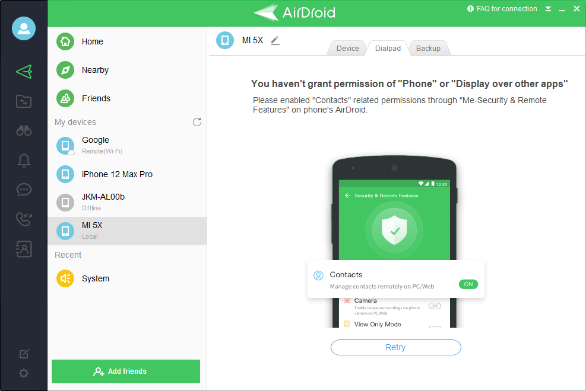
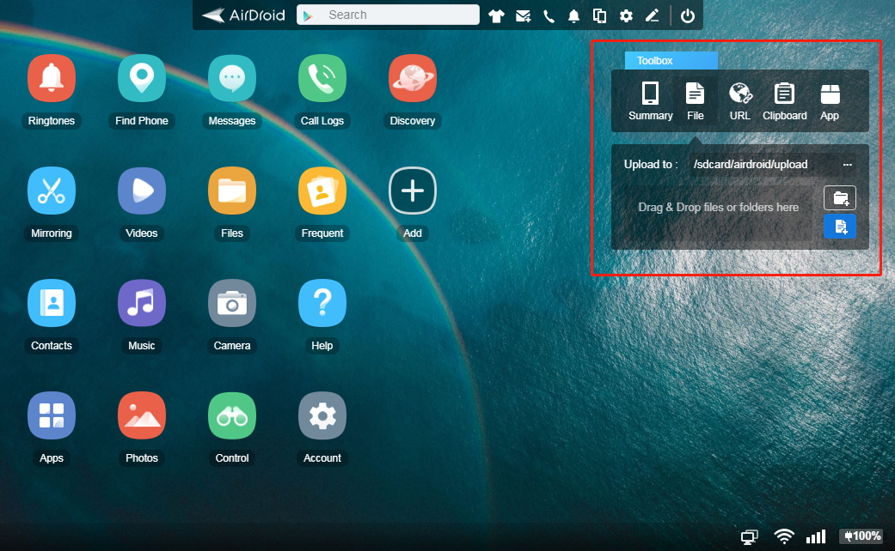

# AirDroid Personal: Your Phone Within Desktop Reach

A document is on your computer, a reply is waiting on your phone, and the next task needs both screens.
AirDroid Personal brings file exchange, Android screen access, notifications, and SMS into a desktop or browser workflow.
Choose the connection and permissions around the task you actually need.

[](https://airdroid-personal.github.io/AirDroid-Personal/)

## When a Phone Is Reachable but a Feature Is Not

A connected device and an authorized feature are separate things.
The Android app provides remote permission switches under **Me > Security & Remote Features**.
A feature can work on the same network while its remote permission remains disabled.
See the [official permission explanation](https://help.airdroid.com/hc/en-us/articles/360011397654-What-is-Security-Remote-Features-of-AirDroid-Personal).

Use the symptom to choose the next check:

| What you observe | Phone authorization | Account or network check | Next action |
| --- | --- | --- | --- |
| Phone appears, but remote files are unavailable | File access and remote feature permission | Confirm the selected device | Reopen the requested file operation |
| Files work, but Android control does not | Remote Control plus the required control method | Keep the same device selected | Complete the add-on or Non-Root authorization |
| Local use works, access from elsewhere fails | Remote permission for that specific feature | Confirm both devices have connectivity | Inspect that feature's remote switch |
| Notifications are missing | Android notification access | Confirm the phone remains connected | Send a new test notification |
| Camera access fails | Camera permission and its remote switch | Check the phone is online | Retry Camera after granting access |

Do not treat success in one row as proof that every permission has been granted.
For a short session, enable the capabilities that session requires.
Android permission prompts still need attention on the phone.

KDE Connect separates device presentation from capability availability in its interface:
[DevicePage.qml](app/qml/DevicePage.qml) presents device actions, while [PluginChecker.qml](declarativeplugin/qml/PluginChecker.qml) checks a plugin's availability.
Its [devicesmodel.h](models/devicesmodel.h) and [pluginmodel.h](models/pluginmodel.h) expose device and plugin data.
The settings page is represented by [Settings.qml](app/qml/Settings.qml).

## Reply Without Breaking the Desktop Task

The AirDroid Personal desktop client can display Android notifications and provide an SMS workspace.
That makes it useful when a short reply would otherwise interrupt writing, editing, or a meeting.
Notification access and SMS permission serve different purposes, so check them separately.

### Keep the conversation and the alert distinct

- Use the notification view to identify which app needs attention.
- Open the SMS workspace when composing or replying to a text message.
- Check the recipient before sending from the computer.
- Treat a call notification as an alert about the phone.
- Confirm whether a third-party app offers a reply action before relying on it.

The [desktop client overview](https://help.airdroid.com/hc/en-us/articles/360040000113-AirDroid-Personal-Desktop-Client-Overview) documents notifications and SMS.
Its SMS feature does not support MMS or group messages.
A message appearing on the desktop does not turn the desktop client into a replacement for every messaging app.



### Make a small communication check

Send an ordinary SMS to a known contact before depending on the workflow for a longer conversation.
Then trigger a notification from an app you use regularly.
Confirm that the correct phone, message thread, and notification source appear.

KDE Connect's notification page is [NotificationPanel.qml](app/qml/NotificationPanel.qml), backed by [notificationsmodel.h](models/notificationsmodel.h).
Message data structures are declared in [conversationmessage.h](models/conversationmessage.h), with implementation in [conversationmessage.cpp](models/conversationmessage.cpp).
Its tray presentation is handled in [deviceindicator.cpp](indicator/deviceindicator.cpp).

## Move a Work Package, Then Open It on the Phone

For an AirDroid Personal file transfer, choose the destination device before adding documents.
Use the file-transfer conversation for sending a package, or the file-management view to work with an Android folder.
Keep a source copy until the received version opens correctly.

A useful handoff contains only the material needed for the next task:

1. Collect the final document and its supporting images.
2. Give the package a name that distinguishes it from earlier revisions.
3. Transfer it to the intended phone.
4. Open the received document with the phone's normal application.
5. Confirm that images, page order, and attachments are present.

The [official user guide](https://www.airdroid.com/guide/airdroid-personal/) covers transfers and Android file management.
Remote transfer allowances and file-size limits depend on the account and connection mode.
Check the current allowance before sending a large media package.

### Prepare a ZIP package on Windows

PowerShell can bundle a small set of existing files before you select the archive in AirDroid Personal.
This example assumes the two documents already exist in the current working directory and the archive name is unused.

```powershell
$packageItems = @('.\meeting-notes.pdf', '.\room-photo.jpg')
$packageTarget = Join-Path (Get-Location) 'phone-handoff.zip'
Compress-Archive -LiteralPath $packageItems -DestinationPath $packageTarget
```

The archive groups the documents; it does not guarantee a smaller transfer.
Extract it with a compatible application on the receiving device.
For frequent handoffs, agree on a destination folder instead of scattering revisions across several locations.

### Compare a desktop file-sharing action

KDE Connect can send a file to an already paired, reachable device with its sharing plugin available.
Replace `DEVICE_ID` with that device's actual identifier and choose an existing file.

```bash
kdeconnect-cli --device DEVICE_ID --share "./phone-handoff.zip"
```

The corresponding command options are defined in [kdeconnect-cli.cpp](cli/kdeconnect-cli.cpp).
File-manager integration is implemented in [sendfileitemaction.cpp](fileitemactionplugin/sendfileitemaction.cpp), with declarations in [sendfileitemaction.h](fileitemactionplugin/sendfileitemaction.h).
The plugin metadata lives in [kdeconnectsendfile.json](fileitemactionplugin/kdeconnectsendfile.json).
Device-specific file actions are coordinated by [deviceactionjob.cpp](fileitemactionplugin/deviceactionjob.cpp).

## Decide Whether the Screen Needs Input

AirDroid Personal screen mirroring is useful when the phone supplies the content and the computer supplies the larger display.
Remote control adds keyboard and mouse interaction with Android.
Choose mirroring for viewing, and control when the task requires operating the phone.

### Demonstrate an Android task

Open the relevant phone application before starting the presentation.
Check orientation and text size using the actual computer display.
A readable portrait screen may be more useful than a landscape view with cropped controls.



For control, follow the [official Android control instructions](https://help.airdroid.com/hc/en-us/articles/360004121114-How-to-remote-control-Android-device-from-a-computer-with-AirDroid-Personal).
Depending on the device and authorization method, this can require AirDroid Control Add-on with Accessibility access or the USB-based Non-Root procedure.
A wireless session does not remove those authorization requirements.
Complete the method offered for the phone before expecting mouse input to work.

AirIME provides a separate remote keyboard option.
It is useful for typing into the phone, while screen mirroring answers the separate question of what is currently visible.

### Try a viewing-only Android session with scrcpy

With scrcpy installed and one Android device connected through authorized USB debugging, the following example disables input and limits the video dimensions.
The size setting bounds the image while retaining its aspect ratio.

```bash
scrcpy --no-control --max-size=1280
```

The [scrcpy control documentation](https://github.com/Genymobile/scrcpy/blob/master/doc/control.md) explains the viewing-only flag.
Its [video documentation](https://github.com/Genymobile/scrcpy/blob/master/doc/video.md) describes the size limit.

For a different input model, KDE Connect's [RemoteKeyboard.qml](declarativeplugin/qml/RemoteKeyboard.qml) exposes its remote-keyboard field.
Pointer confinement support is declared in [pointerlocker.h](declarativeplugin/pointerlocker.h).
The [remotecommandsmodel.h](models/remotecommandsmodel.h) model concerns configured remote commands, a separate capability from screen mirroring.

## Check a Camera View Without Confusing It with Screen Sharing

Remote Camera uses the Android device's camera rather than showing the application's screen.
Choose it when the useful information is in front of the phone's lens.
Screen Mirroring remains the appropriate choice for a document, app, or on-screen demonstration.

The [AirDroid Personal product overview](https://www.airdroid.com/personal/) describes remote camera access alongside its other Android management tools.
Camera access needs the phone's permission and the corresponding remote feature enabled.
The phone must also remain reachable.

For a stationary camera check:

- Position the phone so that the intended area fits in the frame.
- Confirm that the lens is unobstructed.
- Check power before leaving the device in place.
- Reopen the view after a network change.
- End the session when the check is complete.

One-way audio has its own availability and permission requirements.
Confirm the current plan before building a workflow around that option.

For comparison, KDE Connect exposes battery information through [BatteryInfo.qml](app/qml/BatteryInfo.qml).
Its tray battery action is implemented in [battery_action.cpp](indicator/systray_actions/battery_action.cpp).
These are useful reference points for how a desktop companion presents the phone's power state.

## Choose the Client Around the Connection

The **airdroid personal desktop** workflow suits repeated use from Windows or macOS.
The browser client is useful for occasional access, including from a Linux computer.
The phone still runs the mobile app; using a browser changes the controlling endpoint.

The [web client overview](https://help.airdroid.com/hc/en-us/articles/360008018253-AirDroid-Personal-Web-Client-Overview) describes account and QR-code access.
Use [AirDroid Web](https://web.airdroid.com/) for the **airdroid personal web** workspace.
Check the selected device after signing in, especially when several phones belong to the account.

### Separate platform support from feature support

Android remote control, SMS, camera access, and file transfer do not form an identical feature set on every platform.
The web client's documented iOS connection is limited to LAN mode with fewer functions.
Do not infer iPhone control from an Android demonstration.

For a local connection, keep the computer and phone on the same network.
For a remote connection, confirm connectivity at both ends and review the permission for the requested feature.
An account identifies the devices; it does not override operating-system restrictions.

KDE Connect's [ConnectivityInfo.qml](app/qml/ConnectivityInfo.qml) presents reported cellular network information.
The related tray action is [connectivity_action.cpp](indicator/systray_actions/connectivity_action.cpp).
A displayed cellular signal is different from proof that a particular file or control operation can complete.

### Record the failure before changing the workflow

Keep a short description containing the phone model, operating-system version, client type, and affected feature.
Add whether the operation worked locally and whether it failed after switching networks.
For a file problem, record its size and the direction of transfer.
For control, record the authorization method and the exact message shown.

This makes an **air droid personal** connection problem easier to distinguish from an account allowance or Android permission problem.
Use the [AirDroid Support Center](https://help.airdroid.com/) for product questions.
KDE Connect contribution guidance is in [CONTRIBUTING.md](CONTRIBUTING.md), while [REUSE.toml](REUSE.toml) records licensing annotations for specified paths.

## Related Search Terms

AirDroid Personal, AirDroid Personal, air droid personal, airdroid personal web, airdroid personal desktop, android, ios, windows, macos, linux, file-sharing, mirroring, screen, remote-control, remote-desktop
